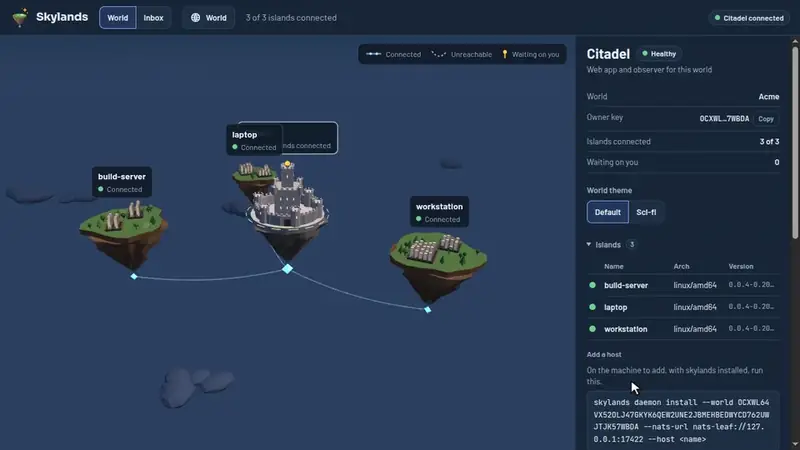

<p align="center">
  <picture>
    <source media="(prefers-color-scheme: dark)" srcset="docs/assets/skylands-lockup-dark.png">
    <source media="(prefers-color-scheme: light)" srcset="docs/assets/skylands-lockup-light.png">
    
  </picture>
</p>

<p align="center">
  <a href="https://skylands.ai">
    
  </a>
</p>

# Skylands

Once developers get past the initial adoption stage and start using AI assistants and harnesses for real work (aka "in anger"), their needs change. Managing multiple agents working in multiple repositories from different locations and apps becomes a real pain and slows down the work. Developers end up herding terminal sessions and VPNs more than they orchestrate agents.

You can use _any agent_ you like, or mix and match however you choose. Skylands supports **Claude Code**, **Gemini**, **Codex**, and **Goose**, with more to come.

Skylands solves that problem by giving you a single interface through which you can dispatch agent work to any machine you have access to, from any browser you like. Tell your agents to start working on your dev box from your laptop and approve permission requests from your phone, all with a fun 3D interface that also supports a unified inbox for all your work.

Skylands gives you a _**secure**, **signed**_ log of everything your agents do and every approval or rejection you provide, no matter where the agent's running or what it's doing. Conversation history is available through a central inbox rather than hidden deep within some obscure sub-directory.

If you want to use Skylands in your agentic development workflow, then check out the documentation at [docs.skylands.ai](https://docs.skylands.ai).

The rest of the information in this README applies mostly to those looking to _contribute_ to Skylands.

## Quickstart

Install Skylands with [Homebrew](https://brew.sh) on macOS or Linux:

```sh
brew tap skylands-ai/tap
brew trust skylands-ai/tap
brew install --cask skylands
```

The [installation page](https://docs.skylands.ai/getting-started/installation/) has the other ways to install it. Then start a world on this machine:

```sh
skylands devworld up
```

`devworld up` runs an embedded NATS server, a citadel, and a daemon for this
machine in one process, so you get the castle and one island. The first time,
it prints a link to set the world up:

```
 Set up this world. Open this link in a browser:

    http://127.0.0.1:8080/setup#...
```

Open it and set the world up. After that, the
world is at <http://127.0.0.1:8080>, and that browser opens it as a valid approver.

---

<p align="center">
  Created with joy by Kevin Hoffman · <a href="https://github.com/autodidaddict">GitHub</a> · <a href="https://www.linkedin.com/in/kevinshoffman/">LinkedIn</a> · <a href="https://kevinhoffman.blog">Blog</a>
</p>
